<p align="center">
  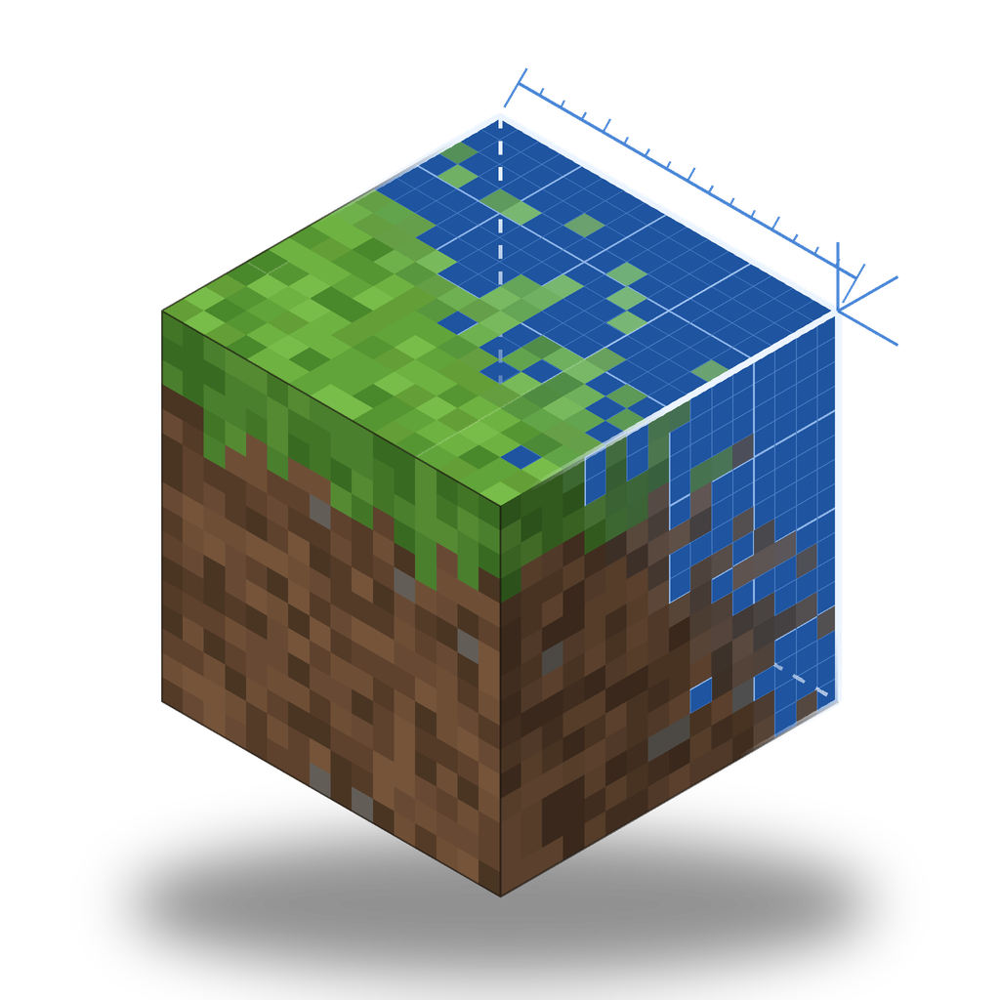
</p>

<h1 align="center">Modscape Manager</h1>

<p align="center">
  <b>Plan Minecraft modpacks as metadata. Pick mods, see how they depend on each other, and export a pack your launcher installs.</b><br>
  <sub>macOS · Linux · Minecraft 1.21.1 and 26.1.2 first-class, any version Modrinth or CurseForge lists · NeoForge · Fabric · Forge · Quilt</sub>
</p>

---

Modscape Manager is a desktop app for *designing* modpacks. You search Modrinth and CurseForge side by side, add mods (their required dependencies come along on their own), and the app keeps checking the whole pack as you go: missing dependencies, mods that clash, mods with no build for your version. When it's right, you export an `.mrpack`, CurseForge zip or packwiz folder and import it into Prism Launcher (or the Modrinth App, ATLauncher, the CurseForge app…).

**It never downloads a mod.** Packs are lists of projects and file versions; the launcher fetches the files when it installs the pack.

- **No accounts, no telemetry.** The app only talks to Modrinth, CurseForge and the loaders' version lists.
- **Your CurseForge API key** (optional) lives in your system keychain, never in a file.
- **Everything is yours:** packs, payloads and templates are stored locally and export as plain JSON and folders.

## Contents

- [Install](#install) · [Quick start](#quick-start)
- **A tour:** [Packs](#packs) · [Workspace](#the-workspace) · [Graph](#graph-view) · [Overrides](#overrides-tab) · [Snapshots](#snapshots) · [Export](#export) · [Payloads](#payloads) · [Templates](#override-templates) · [Settings](#settings) · [Shortcuts](#keyboard-shortcuts)
- [What the checks mean](#what-the-checks-mean) · [Export formats](#export-formats)
- [Building from source](#building-from-source) · [Privacy and network](#privacy-and-network) · [License](#license)

## Install

| | |
|---|---|
| **macOS** (Apple Silicon) | Open `Modscape Manager_<version>_aarch64.dmg` and drag the app to Applications. The app isn't signed with an Apple Developer ID, so the first time, **right-click it → Open → Open**. After that it opens normally. |
| **Linux** (Mint / Ubuntu) | `sudo apt install ./Modscape-Manager_<version>_amd64.deb`, or make the `.AppImage` executable and run it. |
| **From source** | See [Building from source](#building-from-source). Linux has its own step-by-step guide: [docs/LINUX.md](docs/LINUX.md). |

## Quick start

1. **New pack:** name it, pick the Minecraft version and loader; the loader version fills in for you.
2. **Search** on the left and press **+** (or Enter). Required dependencies are added and marked *pulled in by*.
3. Watch the **checks** at the top of the pack. Most problems come with a one-click fix.
4. Optional: drop in a **payload** (a reusable bundle such as *Optimization and Functionality Core*), or attach an **override template** with your configs.
5. **Export…** → `.mrpack` → in Prism: *Add Instance → Import* → pick the file.

> [!TIP]
> Add a CurseForge API key in **Settings** to search CurseForge too. Without one, everything works with Modrinth alone.

---

## Packs

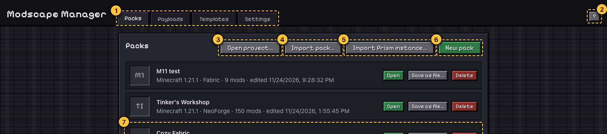

| # | | |
|:-:|---|---|
| 1 | **Main tabs** | Packs (becomes *Workspace* while a pack is open), Payloads, Templates, Settings. ⌘/Ctrl + 1–4 switches between them. |
| 2 | **Shortcuts** | Every keyboard shortcut. `?` opens it from anywhere. |
| 3 | **Open project…** | Opens a planner file (`.json`): the full pack with links, pins, notes, tags, snapshots and layout. |
| 4 | **Import pack…** | Reads an `.mrpack` or CurseForge zip. Files are identified by hash and kept pinned to the versions the pack used; config files can be saved as an override template in one click. |
| 5 | **Import Prism instance…** | Reads a Prism Launcher instance folder (mods, resource packs, shaders, datapacks). It only reads; the instance is never changed. |
| 6 | **New pack** | Name, Minecraft version (any version the sites list), loader and loader version. |
| 7 | **A pack** | Open it, save it as a planner file, or delete it. |

## The workspace

Three panes: **Browse** on the left, **the pack** in the middle (as a list, a graph, or its overrides), **details** on the right.

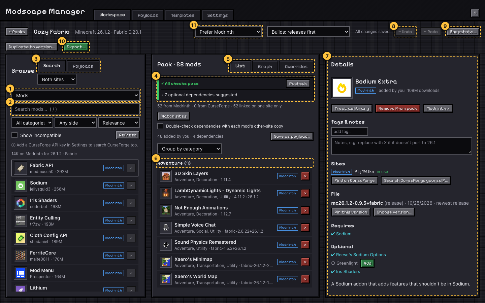

| # | | |
|:-:|---|---|
| 1 | **Content type** | Mods, resource packs, shaders or datapacks. Each has its own categories; hints explain where the files go. |
| 2 | **Search** | Both sites at once, already filtered to the pack's version and loader. `/` jumps here, ↑↓ move, Enter adds. Hover a result for a summary card; click it to preview in Details. |
| 3 | **Search / Payloads** | Switch the left pane to your payloads to drop a whole bundle in. |
| 4 | **Checks** | Re-run on every change. Errors, then warnings, then notes, each with a fix when there is one. Optional dependencies show up as suggestions you can tick and add. |
| 5 | **List · Graph · Overrides** | Three views of the same pack. `G` flips between list and graph. |
| 6 | **Groups** | Group by category, by your first tag, or by *pulled in by*. Resource packs, shaders and datapacks always get their own groups; libraries sit dimmed at the bottom. |
| 7 | **Details** | Everything about one mod: its file (pin a version or let it float to the newest), what it requires and what requires it, tags and notes, and its copies on each site. If matching misses an obvious copy, **Search CurseForge yourself…** links it by hand; the app remembers the link for every pack. |
| 8 | **Undo / Redo** | Every change is undoable (⌘Z / ⇧⌘Z); the button says what it will undo. |
| 9 | **Snapshots…** | Named saves of the whole pack you can compare and roll back to. |
| 10 | **Export…** | `.mrpack`, CurseForge zip, packwiz, Markdown or CSV, with a pre-flight check first. |
| 11 | **Preferred site** | For mods on both sites: prefer Modrinth, prefer CurseForge, or choose per mod. Next to it, *Builds* picks newest-release-first (default) or simply the newest build. |

> [!NOTE]
> **Duplicate to version…** copies the pack to another Minecraft version or loader and reports what has a build there, what doesn't, and which dependencies changed. Dropped dependencies can be kept on purpose.

### Graph view

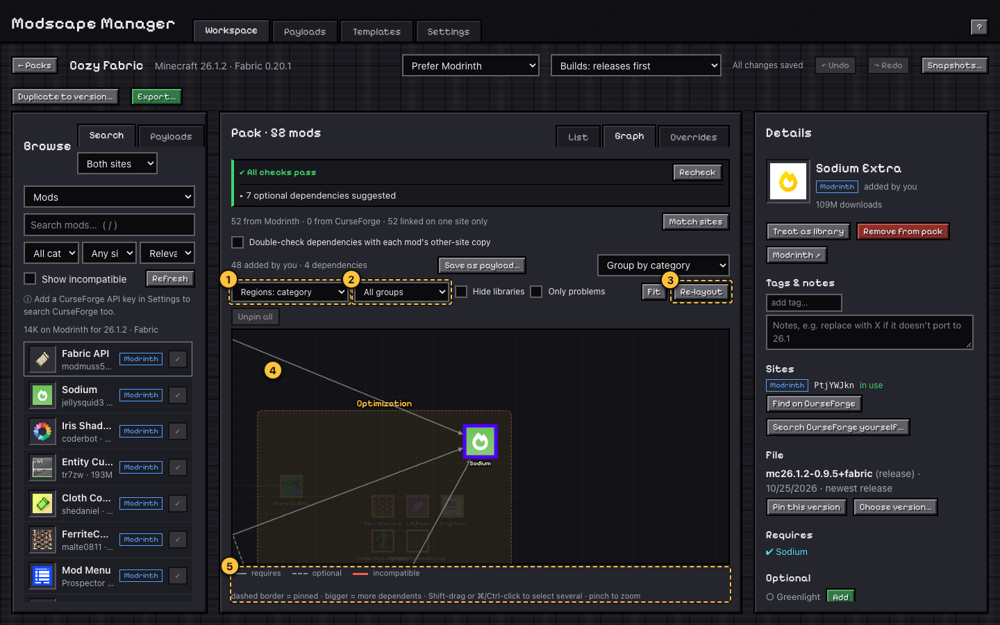

| # | | |
|:-:|---|---|
| 1 | **Regions** | Mods sit inside coloured regions by category, tag or *pulled in by* (independent of the list's grouping unless you sync them in Settings). |
| 2 | **Filters** | Show one group, hide libraries, or only mods with problems. |
| 3 | **Fit / Re-layout** | Re-arrange everything you haven't placed by hand. *Unpin all* releases the ones you have. |
| 4 | **The graph** | Click a mod to light up its whole chain both ways; ⌘/Ctrl- or ⇧-click and ⇧-drag select several (a bar appears for pinning, versions and tags); right-click for actions; drag to place (placed nodes get a dashed border and stay put). Bigger nodes have more dependents; red borders are errors. Drag a search result onto the canvas to add it right there. |
| 5 | **Legend** | Solid = requires, dashed = optional, red = incompatible. |

### Overrides tab

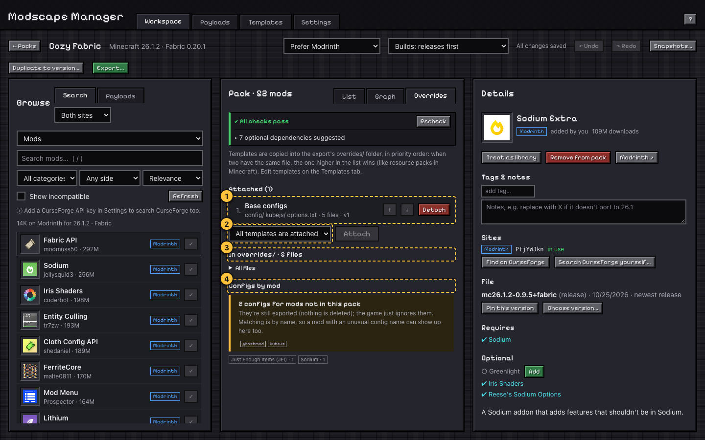

| # | | |
|:-:|---|---|
| 1 | **Attached templates** | In priority order: when two templates have the same file, **the one higher in the list wins** (like resource packs in Minecraft). ↑↓ reorder. |
| 2 | **Attach** | Pick a template from your library. |
| 3 | **In overrides/** | What the export will carry, and which files clash (who overrides whom). |
| 4 | **Configs by mod** | Config files are matched to the pack's mods by path (`config/jei/…` → JEI). Configs for mods that aren't in the pack are flagged, never deleted. When a template changes, a *changed v2 → v4 · Review* notice lists what was added, changed and removed. |

### Snapshots

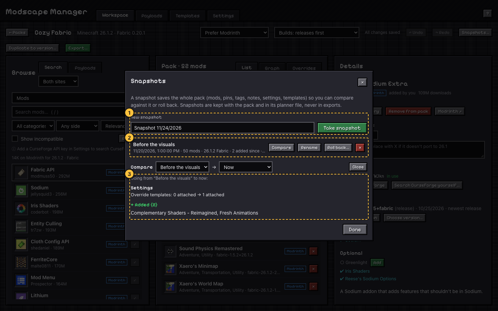

| # | | |
|:-:|---|---|
| 1 | **Take a snapshot** | Saves the whole pack (mods, pins, tags, notes, settings, templates) under a name. |
| 2 | **A snapshot** | Shows what changed since. Compare, rename, roll back (with an automatic "before rolling back" snapshot, and undoable), or delete. |
| 3 | **Compare** | Any two snapshots, or one with now: settings, mods added and removed (yours apart from dependencies), and per-mod changes. |

### Adding a payload

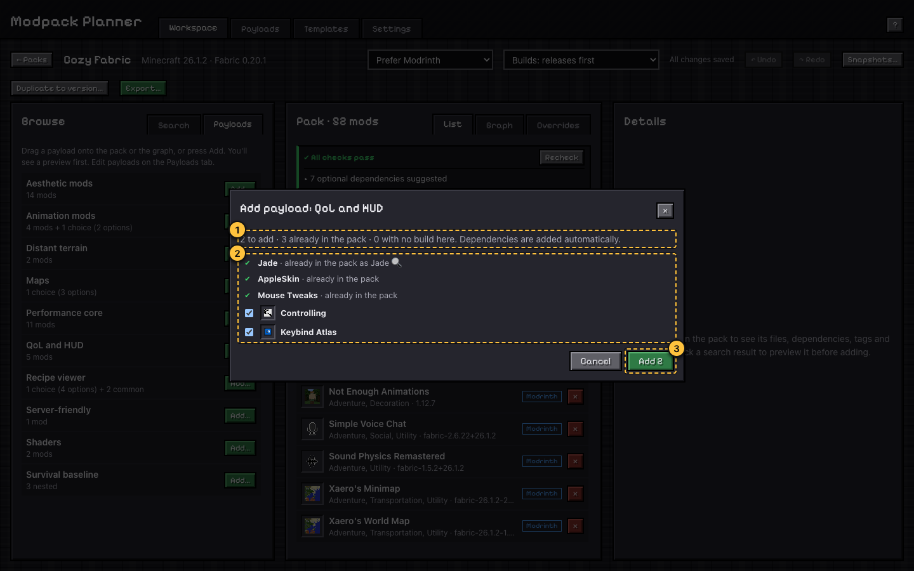

| # | | |
|:-:|---|---|
| 1 | **Summary** | What will be added, what's already there, what has no build for this pack. |
| 2 | **Rows** | Untick anything you don't want. *One of* choices show their options as buttons. When a payload you used has changed, **Review** shows this same preview, including mods the payload no longer has (with warnings if other mods still need them). |
| 3 | **Add** | Adds the ticked mods and their dependencies in one undoable step. |

### Export

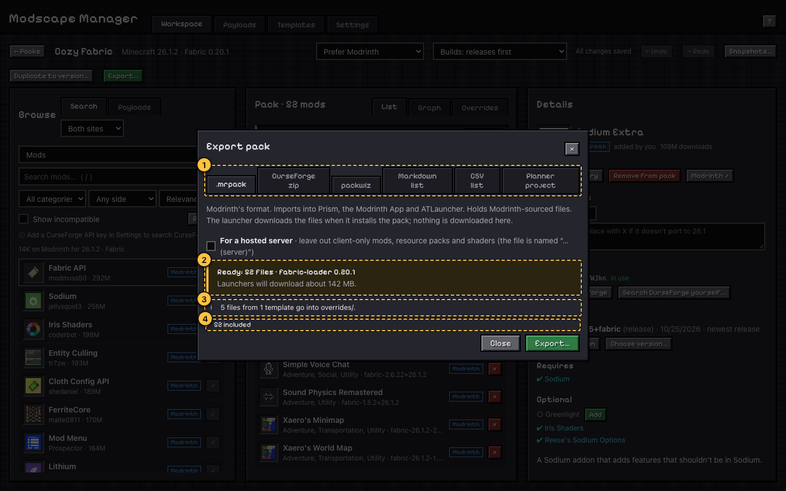

| # | | |
|:-:|---|---|
| 1 | **Format** | `.mrpack`, CurseForge zip, packwiz, Markdown list, CSV list, or the planner project file. |
| 2 | **Pre-flight** | Ready or not, how many files, the loader, and roughly how much the launcher will download. Tick **For a hosted server** above it to leave out client-only mods (as Modrinth marks them), resource packs, shaders, dependencies only those needed, and client-only override files; the export is named "… (server)". |
| 3 | **Problems** | Mods set to the other site (with a *Switch all* fix), distribution-blocked files, template notes. Errors block the export; warnings don't. |
| 4 | **Included / not included** | Every file and where it goes (`mods/`, `resourcepacks/`, `shaderpacks/`, `config/paxi/datapacks/`). |

## Payloads

Payloads are reusable bundles you drop into any pack. They store *projects*, not files, so one payload works on every Minecraft version and loader. A set of starter payloads comes with the app, and new builds update the ones you haven't edited. Want to add your own to the starters? See [docs/PAYLOADS.md](docs/PAYLOADS.md).

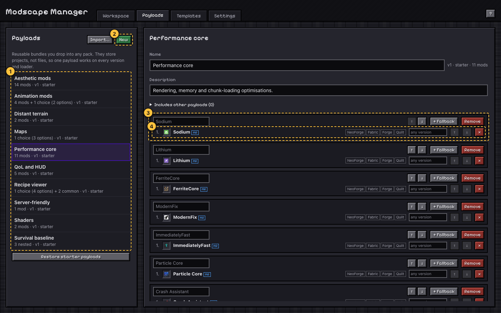

| # | | |
|:-:|---|---|
| 1 | **Library** | Your payloads and the starters. *Restore starter payloads* brings back any you deleted. **Import…** reads a payload JSON someone shared. |
| 2 | **New** | Start an empty payload (or save one from a pack with **Save as payload…**, which leaves dependencies out). |
| 3 | **A slot** | One mod, with ↑↓ to reorder. |
| 4 | **Candidates** | Fallbacks in order: the first that fits the pack and has a build wins. Each can be limited to loaders (e.g. C2ME's Fabric and NeoForge projects) and to Minecraft versions (`26.*` matches a prefix), and **Pin…** can fix it to one exact file, even one built for another loader when a mod needs exactly that (Roxy runs Voxy's 1.21.11 Fabric file on NeoForge 1.21.1). Resource packs, shaders and datapacks work as candidates too. |
| 5 | **+ Choice** | A *one of* item (e.g. JEI or EMI or REI), with mods common to every option. Payloads can also include other payloads. |
| 6 | **Save** | Payloads change only when you save (leaving with unsaved edits asks first). Content changes bump the version, and packs that used it get an *updated → Review* notice. |

## Override templates

Your own reusable `config/`, `kubejs/` and similar folders. They're plain folders in the app's data folder, so you can also edit them with your own tools, back them up or keep them in git.

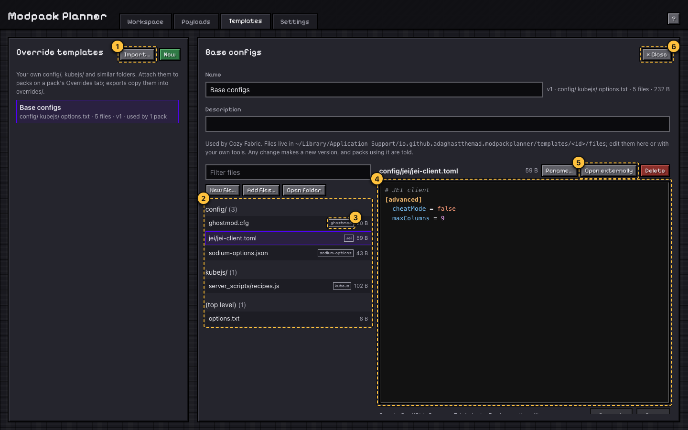

| # | | |
|:-:|---|---|
| 1 | **Import…** | From a folder, a Prism instance, or a modpack's overrides. You pick which top-level folders to keep; mods, worlds and logs are never offered. |
| 2 | **Files** | Grouped by top folder, with a filter. *New file*, *Add files* from disk, *Open folder*. |
| 3 | **Mod hint** | Which mod a config belongs to, when the path makes it obvious. |
| 4 | **Editor** | Small text files (`.toml`, `.json`, `.js`, `.cfg`, …) open here with syntax highlighting. ⌘/Ctrl+S saves; Tab indents. Any change (here or outside the app) makes a new version. |
| 5 | **Open externally** | Anything bigger or binary opens in your own editor. |
| 6 | **Close** | Back to the list. The open template is remembered while the app runs. |

## Settings

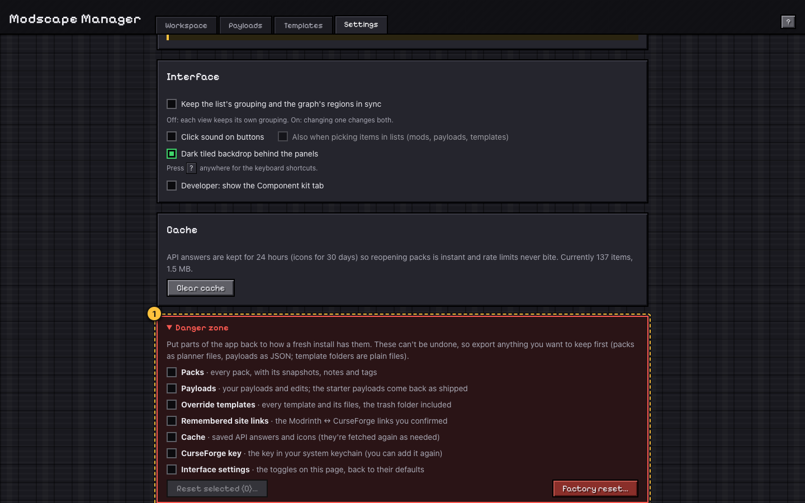

- **CurseForge key:** paste it once; it's saved in the system keychain. A connection test shows a live search.
- **Interface:** keep list grouping and graph regions in sync; an optional button click sound (and one for picking list items); the tiled backdrop.
- **Cache:** API answers are kept for 24 hours (icons for 30 days). Clear it any time.
- **Danger zone (1):** reset parts of the app to a fresh install's state: packs, payloads (back to the starters), templates, remembered site links, cache, the CurseForge key, interface settings. Or **Factory reset** everything (type `RESET` to confirm). Export anything you want to keep first.

## Keyboard shortcuts

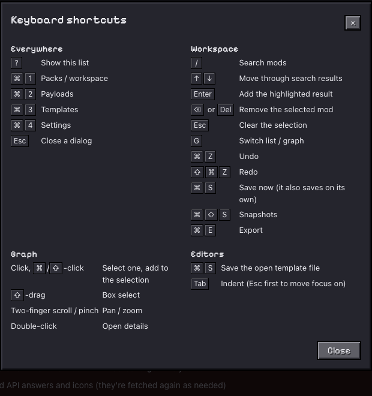

macOS uses ⌘, Linux uses Ctrl. Backspace or Delete removes the selected mod.

---

## What the checks mean

| Check | Meaning | Fix offered |
|---|---|---|
| **Missing dependency** | A mod requires something that isn't in the pack. | Add it (as that mod's dependency). |
| **Incompatible** | Two mods declare they don't work together. Includes known clashes the sites don't list (e.g. Sodium vs Embeddium). | Remove one. |
| **No build** | No file for this Minecraft version and loader. | Remove it. |
| **Pinned file missing / for another version** | A pinned version is gone or doesn't fit. | Unpin. |
| **Version mismatch** | A mod asks for an exact version of a dependency, and the pack uses another. | Pin that version. |
| **Not updated in over a year** | The newest build is old (skipped for pinned mods). | – |
| **Shader packs need Iris** | A shader is in the pack without Iris (Oculus on Forge). | Add Iris / Oculus. |
| **Datapacks without Paxi** | Without Paxi, datapacks have to be added to each world by hand. | Add Paxi. |
| **Datapack that's also a mod** | e.g. Terralith: the mod is usually the better pick. | Use the mod. |
| **Made for another version** | A resource pack or shader has no build marked for your version; the newest one is used. Usually fine. | – |
| **Distribution blocked** | A CurseForge author blocks third-party downloads; the launcher will ask you to download it by hand. | Use Modrinth (when linked). |
| **Unneeded dependency** | Nothing needs this library any more. | Remove it. |

## Export formats

| Format | Holds | For |
|---|---|---|
| **`.mrpack`** | Modrinth-sourced files, plus overrides | Prism, Modrinth App, ATLauncher |
| **CurseForge zip** | CurseForge-sourced files, plus overrides | CurseForge app, Prism |
| **packwiz** | Both sites mixed (one `.pw.toml` per file), overrides at the root | packwiz-installer, git-based packs |
| **Markdown / CSV** | A readable list: name, type, version, site, link, category | Pack pages, spreadsheets |
| **Planner project** | Everything (`.json`) | Backups, sharing, git |

Every format except the project file also has a **hosted server** variant. Mods CurseForge has no side information for are kept, and listed so you can check them.

Datapacks go to Paxi's global folder (`config/paxi/datapacks/`) in `.mrpack` and packwiz exports. In CurseForge zips the launcher chooses: Prism puts them in `datapacks/`, which Paxi 5.1.3+ also loads.

## Building from source

```bash
scripts/setup.sh        # checks everything first, asks before installing anything (and before sudo)
scripts/dev.sh          # run with hot reload
scripts/build.sh        # tests, then installers in installers/  (.dmg on macOS, .deb + .AppImage on Linux)
```

- **Linux:** [docs/LINUX.md](docs/LINUX.md) walks through it, or run `scripts/linux-build.sh` on the Linux machine.
- **Tests:** `cd src-tauri && cargo test` (resolver tests run on recorded API responses), `pnpm typecheck`.
- **Stack:** Tauri 2 (Rust core: every network call, SQLite storage, the resolver and exporters) with a React + TypeScript UI; the graph uses Cytoscape.js.
- `scripts/starters.py` manages the shipped starter payloads ([docs/PAYLOADS.md](docs/PAYLOADS.md)); `scripts/make-icon.py` draws the app icon; `scripts/capture-screens.mjs` regenerates these screenshots.

## Privacy and network

- The Rust core makes every request and refuses any host not on its allow-list: `api.modrinth.com`, `cdn.modrinth.com`, `api.curseforge.com`, `media.forgecdn.net` (icons), and the loaders' version lists (`meta.fabricmc.net`, `meta.quiltmc.org`, `maven.neoforged.net`, `maven.minecraftforge.net`). The interface itself can't reach the network. No analytics, no crash reporting, no update pings.
- The CurseForge key is stored in the macOS Keychain or the Linux Secret Service. If there's no keychain, the app runs Modrinth-only rather than store it in a file.
- Exports carry no personal information (the pack author field is left empty).
- Data lives in your OS app-data folder (`io.github.adaghastthemad.modscapemanager`). **Settings → Danger zone** resets any part of it.

## License

[MIT](LICENSE) © 2026 AdaghastTheMad.

Modscape Manager is not affiliated with or endorsed by Mojang Studios, Microsoft, Modrinth or CurseForge. "Minecraft" is a trademark of Mojang Studios. The app icon and all UI art are original; no game textures, sounds or fonts are included (headings use [Pixelify Sans](https://fonts.google.com/specimen/Pixelify+Sans), OFL).
